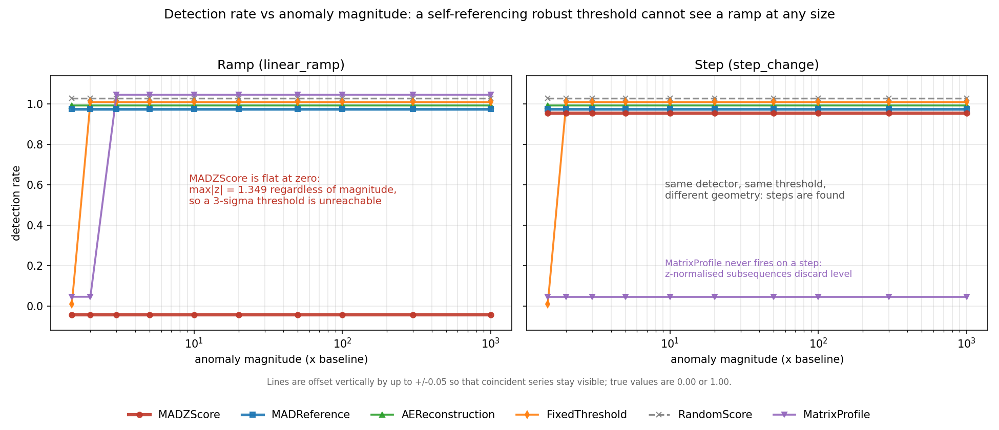

# tsad-harness

A test harness for time-series anomaly detectors. It generates signals with
known ground truth, runs several standard detectors against them, and reports
exactly which failure geometries each detector **cannot** see — plus two
controls that catch a detector "finding" something that is an artifact of its
own training window.

---

## The problem

You have a detector and it looks fine. It fires on the step changes in your
test data, it fires on the spikes, its false-positive rate is low, and the
dashboard is green. How do you know it can see the failure mode you actually
care about?

## The answer people usually give

Run it on a benchmark and report F1. This does not work, for reasons Wu and
Keogh set out in detail: the standard benchmarks are largely trivial,
frequently mislabelled, and dominated by point anomalies, and the most-used
metric credits an entire event to any detector that lands a single point inside
it ([arXiv:2009.13807](https://arxiv.org/abs/2009.13807)).

This repository adds a sharper objection. A detector can be **structurally
incapable** of reporting a whole class of fault while scoring well on every
benchmark you own, because those benchmarks do not contain the geometry that
breaks it. No amount of F1 on step-and-spike data will surface that.

## What I measured

I built nine signal generators with known ground truth (ramps of two shapes,
steps with and without recovery, spikes, seasonal-plus-trend, irregular
sampling, and two generators containing **no anomaly at all**), ran six
detectors across a magnitude sweep spanning 1.5x to 1000x, and scored everything
three ways — point-wise, event-wise, and point-adjusted — with a uniform random
detector present in every table as a floor.

## What I concluded

**A self-referencing robust z-score cannot detect a linear ramp at any
magnitude.** Not "detects it late" — cannot detect it, ever, at any severity.

If a detector computes its median and MAD from the same series it is scoring,
then for a ramp of range R the deviations from the median are uniform on
[-R/2, +R/2], so the scaled MAD is 0.37065·R while the largest deviation is
0.5·R. R cancels:

> **max|z| = 0.5 / (0.25 × 1.4826) = 1.3489815…, independent of R**

A 1000x ramp is exactly as invisible as a 2x ramp. Any threshold above ~1.35 is
unreachable by construction, and the conventional 3-sigma rule can never fire.
Measured residual against the closed form: **0.0**, exactly, across three orders
of magnitude.



The fix is structural, not a matter of tuning: compute the median and MAD over
a **declared stationary reference window** instead of over the series being
scored. Same functional form, same threshold, same input — detection rate goes
from 0.00 to 1.00 at every magnitude.

---

## Quickstart

```bash
pip install -e ".[dev,mp]"
pytest
python -m tsadharness.cli run --out results/
```

The third command regenerates every CSV, figure and table in this repository.
Nothing in `results/` is hand-entered.

---

## Headline results

Detection rate on `linear_ramp`, five seeds per cell (`results/sweep.csv`):

| detector | 1.5x | 2x | 5x | 10x | 100x | 1000x |
|---|---|---|---|---|---|---|
| **MADZScore** (self-referencing) | 0.00 | 0.00 | 0.00 | 0.00 | 0.00 | 0.00 |
| **MADReference** (declared window) | 1.00 | 1.00 | 1.00 | 1.00 | 1.00 | 1.00 |
| AEReconstruction | 1.00 | 1.00 | 1.00 | 1.00 | 1.00 | 1.00 |
| FixedThreshold | 0.00 | 1.00 | 1.00 | 1.00 | 1.00 | 1.00 |
| RandomScore | 1.00 | 1.00 | 1.00 | 1.00 | 1.00 | 1.00 |
| MatrixProfile | 0.00 | 0.00 | 1.00 | 1.00 | 1.00 | 1.00 |

The `MADZScore` row is flat at zero. That row is the project.

Note that `RandomScore` also reads 1.00. That is not a bug, it is the control
working: **a detection rate means nothing without the false-positive rate beside
it.** See below.

### The ceiling, measured

`results/ramp_ceiling.csv`, noiseless ramps, n=1001:

| ramp range R | 1 | 4 | 9 | 99 | 999 |
|---|---|---|---|---|---|
| measured max\|z\| | 1.348981518953 | 1.348981518953 | 1.348981518953 | 1.348981518953 | 1.348981518953 |
| residual vs closed form | 0.0 | 0.0 | 0.0 | 0.0 | 0.0 |

### False positives, with nothing to find

Ground truth is all-False on both geometries, so every non-zero entry is an
error (`results/false_positives.csv`, 20 seeds):

| detector | pure_noise (series FP) | regime_switch (point FP) |
|---|---|---|
| MADZScore | 0.90 | **0.000** |
| MADReference | 0.95 | **0.500** |
| AEReconstruction | 0.05 | 0.562 |
| FixedThreshold | **0.00** | **0.000** |
| RandomScore | 1.00 | 0.011 |
| MatrixProfile | 0.00 | 0.000 |

---

## Negative results

Things that did not work, or that worked for the wrong reason. These are the
most useful part of the repository.

**1. The fix is worse than the bug on benign regime changes.** `MADReference`
flags 50% of all points on `regime_switch`, a healthy asset alternating between
two normal operating levels, because the second mode lies outside its reference
window. `MADZScore` flags *none* of them — it is immune to benign regime change
for exactly the same reason it is blind to ramps: it has no fixed notion of
normal. The trade is real and neither answer is free. This is what the
disjoint-window control is for.

**2. MatrixProfile's ramp detection rate of 1.00 is spurious.** 89% of the
points it flags on a ramp lie in the flat *baseline* before the ramp begins;
its point precision is 0.107. It is credited with a detection only because a
subsequence starting in the baseline extends one window-length into the
labelled region. Reported alone, that 1.00 would be a false claim — which is
why `outside_gt_fire_fraction` sits next to every detection rate in
`sweep.csv`. Separately, `stumpy` z-normalizes subsequences, which discards
level by construction, so it never detects a step change at any magnitude.

**3. The blindness is about uniformity, not gradualness.** I expected the
result to generalise to "robust z-scores cannot see slow change". It does not.
An *exponential* ramp to the same final value **is** detected from ~10x upward,
because its values bunch towards the bottom of the range so the median and the
extreme deviation stop scaling together. The linear ramp is the worst case
precisely because its values are uniformly distributed.

**4. The claim has a stated boundary.** The bound holds only while the ramp
occupies at least 3/4 of the scored window. Above a baseline fraction of 1/4
the ceiling rises (1.349 → 1.686 at b=0.30, → 3.372 at b=0.40) and the ramp
becomes visible again. The effective breakdown point for a ramp is 1/4, against
1/2 for a step. Both boundaries are asserted in `tests/test_derivation.py`.

**5. Point-adjusted F1 is not usable.** A uniform random scorer earns
point-adjusted F1 > 0.9 on a long event while its honest point-wise F1 is
< 0.1. All three scorings ship side by side so the gap is visible rather than
inferred.

**6. A 3-sigma rule is not silent on noise.** ~0.27% of Gaussian samples cross
3 sigma, so over 1000 points at least one crossing is near-certain — hence the
0.90–0.95 series-level false-positive rates above. Per-point thresholds need a
persistence requirement to be usable; the onset control uses five consecutive
samples.

---

## The two controls

**Temporal-generalization artifact** (`controls/disjoint_window.py`). A model
trained on [t0, t1] often flags a "rise" starting just after t1 — not because
anything happened, but because the model does not generalize past its training
window. The control trains a second model on a **non-overlapping** window and
rescores the same period. If the two disagree about the absolute error level,
the finding is a property of the pipeline, not the data.

The constructed demonstration uses a healthy two-mode asset whose ground truth
is all-False. A single-model pipeline reports a confident finding; the two
models disagree by **47.8x**; `is_artifact` is True. The paired case
(`corroborated_demo`) puts a real step change through the same control, the
models agree to within **1.003x**, and the finding passes.

**Onset instability** (`controls/window_shift.py`). For a ramp, the "detected
onset date" is an artifact of the baseline window, not a physical time. The
control recomputes onset under five baseline windows:

| geometry | onset spread | classification | `suppress_lead_time_claim` |
|---|---|---|---|
| `step_change` | **0 samples** | `step_type` | `False` |
| `linear_ramp` | **454 samples** (45% of series) | `ramp_type` | `True` |

A step's onset is the same index under every baseline window. A ramp's moves by
nearly half the series. **Never report "detected N days early" for a ramp** —
the suppression flag is a machine-readable field rather than a footnote,
because a caveat in prose gets dropped when the number is copied into a slide.

---

## Layout

```
src/tsadharness/
  signals.py              9 generators, known ground truth
  detectors/
    base.py               Detector protocol + RAMP_BLINDNESS_CONSTANT
    mad_z.py              self-referencing robust z    <- the one that fails
    mad_ref.py            declared reference window    <- the fix
    ae_recon.py           pure-NumPy bottleneck autoencoder (no torch)
    matrix_profile.py     stumpy discords (import-guarded)
    threshold.py          fixed absolute level
    random_.py            uniform random               <- the honesty check
  protocol.py             point-wise / event-wise / point-adjusted, sweeps
  controls/
    disjoint_window.py    temporal-generalization artifact
    window_shift.py       onset stability
  report.py, cli.py       one command regenerates everything
paper/ramp_blindness.md   full derivation + measured verification
results/                  committed CSVs and figures
tests/                    287 tests (286 pass, 1 skips without stumpy)
```

Detectors implement one protocol:

```python
class Detector(Protocol):
    name: str
    def fit(self, series: np.ndarray) -> None: ...
    def score(self, series: np.ndarray) -> np.ndarray: ...   # higher = more anomalous
```

`fit` deliberately receives the whole series. Which part of it a detector may
treat as "normal" is a modelling decision, and forcing each one to declare it
is the comparison this harness exists to make.

---

## Notes

- The autoencoder is pure NumPy on purpose — the harness stays installable with
  NumPy, SciPy and matplotlib. It is deliberately minimal and is not a
  competitive reconstruction model; its role is to represent the class of
  detectors that train on a declared window.
- `stumpy` is optional. Without it the matrix-profile detector is omitted from
  the tables and its tests skip with a message.
- Everything is seeded. Every generator is reproducible from its metadata.
- All data is synthetic and every result is derived from first principles.

The companion project **[bearing-watch](https://github.com/johnhagedorncs/bearing-watch)**
applies this result: it calibrates its threshold against a declared stationary
reference window, the same rule as `MADReference` here, on vibration data from a
run-to-failure bearing test.

## Licence

MIT — see [LICENSE](LICENSE).
