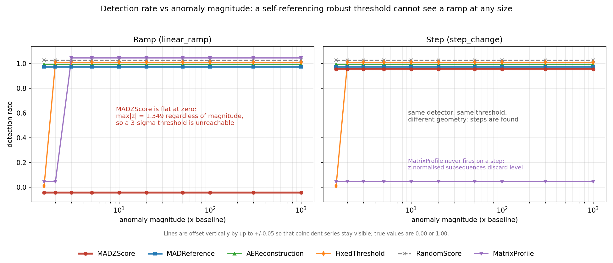
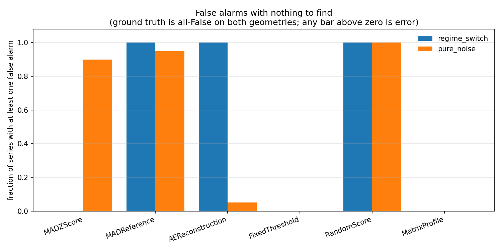

# tsad-harness results

All numbers below are regenerated by `python -m tsadharness.cli run --out results/`. Nothing here is hand-entered.

## 1. The ramp ceiling

A self-referencing robust z-score computes its median and MAD from the same series it scores. On a ramp of range R the deviations from the median are uniform on [-R/2, +R/2], so the scaled MAD is 0.37065*R while the largest deviation is 0.5*R. R cancels exactly:

| magnitude | ramp range R | measured max|z| | analytic | residual | fires at 3-sigma? |
|---|---|---|---|---|---|
| 2.000 | 1.000 | 1.349 | 1.349 | 0.000 | 0.000 |
| 5.000 | 4.000 | 1.349 | 1.349 | 0.000 | 0.000 |
| 10.000 | 9.000 | 1.349 | 1.349 | 0.000 | 0.000 |
| 100.000 | 99.000 | 1.349 | 1.349 | 0.000 | 0.000 |
| 1e+03 | 999.000 | 1.349 | 1.349 | 0.000 | 0.000 |

The measured ceiling does not move across three orders of magnitude of R. A 1000x ramp is exactly as invisible as a 2x ramp.

## 2. Detection rate vs magnitude

### Ramp geometry (`linear_ramp`)

| detector | 1.5x | 2x | 3x | 5x | 10x | 20x | 50x | 100x | 300x | 1000x |
|---|---|---|---|---|---|---|---|---|---|---|
| MADZScore | 0.000 | 0.000 | 0.000 | 0.000 | 0.000 | 0.000 | 0.000 | 0.000 | 0.000 | 0.000 |
| MADReference | 1.000 | 1.000 | 1.000 | 1.000 | 1.000 | 1.000 | 1.000 | 1.000 | 1.000 | 1.000 |
| AEReconstruction | 1.000 | 1.000 | 1.000 | 1.000 | 1.000 | 1.000 | 1.000 | 1.000 | 1.000 | 1.000 |
| FixedThreshold | 0.000 | 1.000 | 1.000 | 1.000 | 1.000 | 1.000 | 1.000 | 1.000 | 1.000 | 1.000 |
| RandomScore | 1.000 | 1.000 | 1.000 | 1.000 | 1.000 | 1.000 | 1.000 | 1.000 | 1.000 | 1.000 |
| MatrixProfile | 0.000 | 0.000 | 1.000 | 1.000 | 1.000 | 1.000 | 1.000 | 1.000 | 1.000 | 1.000 |

### Step geometry (`step_change`) - the positive control

| detector | 1.5x | 2x | 3x | 5x | 10x | 20x | 50x | 100x | 300x | 1000x |
|---|---|---|---|---|---|---|---|---|---|---|
| MADZScore | 1.000 | 1.000 | 1.000 | 1.000 | 1.000 | 1.000 | 1.000 | 1.000 | 1.000 | 1.000 |
| MADReference | 1.000 | 1.000 | 1.000 | 1.000 | 1.000 | 1.000 | 1.000 | 1.000 | 1.000 | 1.000 |
| AEReconstruction | 1.000 | 1.000 | 1.000 | 1.000 | 1.000 | 1.000 | 1.000 | 1.000 | 1.000 | 1.000 |
| FixedThreshold | 0.000 | 1.000 | 1.000 | 1.000 | 1.000 | 1.000 | 1.000 | 1.000 | 1.000 | 1.000 |
| RandomScore | 1.000 | 1.000 | 1.000 | 1.000 | 1.000 | 1.000 | 1.000 | 1.000 | 1.000 | 1.000 |
| MatrixProfile | 0.000 | 0.000 | 0.000 | 0.000 | 0.000 | 0.000 | 0.000 | 0.000 | 0.000 | 0.000 |

## 3. False positives with nothing to find

Ground truth is all-False on both geometries below, so every non-zero entry is an error. Read this table before reading any recall number above it.

| detector | geometry | series FP rate | point FP rate | mean false events |
|---|---|---|---|---|
| MADZScore | regime_switch | 0.000 | 0.000 | 0.000 |
| MADZScore | pure_noise | 0.900 | 0.003 | 2.500 |
| MADReference | regime_switch | 1.000 | 0.500 | 3.150 |
| MADReference | pure_noise | 0.950 | 0.004 | 4.200 |
| AEReconstruction | regime_switch | 1.000 | 0.562 | 3.000 |
| AEReconstruction | pure_noise | 0.050 | 0.0003 | 0.150 |
| FixedThreshold | regime_switch | 0.000 | 0.000 | 0.000 |
| FixedThreshold | pure_noise | 0.000 | 0.000 | 0.000 |
| RandomScore | regime_switch | 1.000 | 0.011 | 11.000 |
| RandomScore | pure_noise | 1.000 | 0.011 | 11.000 |
| MatrixProfile | regime_switch | 0.000 | 0.000 | 0.000 |
| MatrixProfile | pure_noise | 0.000 | 0.000 | 0.000 |

## 4. A detection rate is meaningless on its own

Detection rate asks only whether a detector fired *somewhere* inside the event. The column beside it asks what fraction of everything it fired on was healthy data. A detector can score 1.00 on the first while being wrong almost every time it speaks.

| detector | detection rate | fraction of firings on healthy data | point precision |
|---|---|---|---|
| MADZScore | 0.000 | 0.000 | 0.000 |
| MADReference | 1.000 | 0.001 | 0.999 |
| AEReconstruction | 1.000 | 0.000 | 1.000 |
| FixedThreshold | 1.000 | 0.000 | 1.000 |
| RandomScore | 1.000 | 0.273 | 0.727 |
| MatrixProfile | 1.000 | 0.893 | 0.107 |

The `MatrixProfile` row is the cautionary one. Its detection rate on ramps reads 1.00, but almost every point it flags lies in the flat baseline before the ramp begins; it is credited with a detection only because a subsequence starting in the baseline extends a window's length into the labelled region. Reported alone, that 1.00 would be a straightforwardly false claim.

## 5. Metric inflation: point-adjusted F1

The same predictions scored three ways on the step geometry at 10x. Point-adjusted F1 credits an entire ground-truth event to any detector that lands a single point inside it, which is why `RandomScore` is competitive under it and worthless under the other two.

| detector | point F1 | event F1 | point-adjusted F1 (inflated) |
|---|---|---|---|
| MADZScore | 1.000 | 1.000 | 1.000 |
| MADReference | 0.990 | 0.453 | 0.990 |
| AEReconstruction | 1.000 | 1.000 | 1.000 |
| FixedThreshold | 1.000 | 1.000 | 1.000 |
| RandomScore | 0.009 | 0.167 | 0.976 |
| MatrixProfile | 0.000 | 0.000 | 0.000 |

## 6. Controls

| control | case | expected | is_artifact | classification | suppress lead time | A/B ratio | onset spread |
|---|---|---|---|---|---|---|---|
| disjoint_window | artifact_demo (healthy two-mode asset, no anomaly exists) | is_artifact=yes | yes |  |  | 47.750 |  |
| disjoint_window | corroborated_demo (real step change) | is_artifact=no | no |  |  | 1.003 |  |
| onset_stability | linear_ramp | classification=ramp_type |  | ramp_type | yes |  | 454 |
| onset_stability | step_change | classification=step_type |  | step_type | no |  | 0 |

- **artifact_demo (healthy two-mode asset, no anomaly exists)** - ARTIFACT: model A (trained on (0, 200)) reports a finding that model B (trained on (600, 800)) does not corroborate; error levels differ by 47.8x. The finding is a property of the training window.
- **corroborated_demo (real step change)** - CORROBORATED: both models report a comparable error level in (800, 1000) (ratio 1.00x). The finding is a property of the data.
- **linear_ramp** - onset moved 454 samples (45.4% of the series) across 5 baseline windows, exceeding the 2.0% tolerance; the onset is a function of the baseline window, not a time
- **step_change** - onset was stable to 0 samples (0.0%) across all 5 baseline windows; the onset is a physical instant
